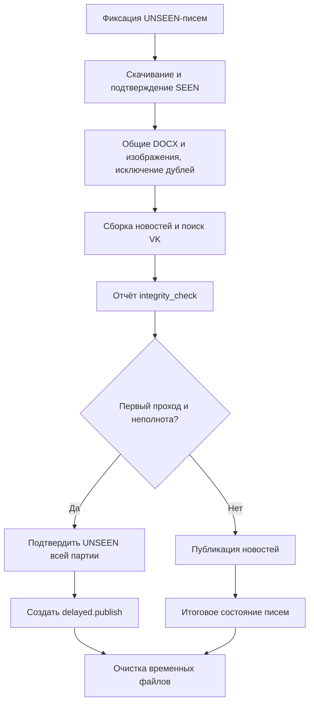

# Zanevka Newsbot — конвейер обработки материалов

Описание действующей логики Python-конвейера. Общие компоненты, жизненный цикл и файлы состояния — [system.md](system.md). Обязательные правила — ADR-002, ADR-003 и ADR-004 в [decisions.md](../decisions.md).

## Общий поток

Технические ошибки подготовки останавливают партию, а не переводят её в штатную отсрочку. При отсутствии подходящих писем конвейер завершает проверку без публикации.

## Получение писем

- `mail_downloader.connect_mail()` открывает IMAP SSL-соединение, выполняет login и select настроенного ящика. `search_unseen_news()` выбирает непрочитанные письма по настроенному IMAP_SUBJECT (в примере — ЗГП), в порядке UID.
- `download_news_batch()` фиксирует список один раз. Письма, поступившие после этого, остаются для следующего запуска. Для каждого UID вызывается download_with_retries(), затем reserve_downloaded_email(); возвращается список (uid, путь EML, subject).
- Скачивание использует временный .part и повторные попытки. Резервирование подтверждает SEEN сервера до подготовки материалов. После исчерпания retry загрузчик пытается пометить нескачанное письмо SEEN и подтвердить этот флаг; затем пакетный путь останавливает всю партию, без перехода на одиночный загрузчик. Если подтверждение SEEN не удалось, фактическое состояние письма проверяет администратор.
- Почтовый ящик используется ботом и администратором. Письма, уже прочитанные или перемещённые другим клиентом, не восстанавливаются автоматически.
- Текущий `IMAP4_SSL` вызывается без явно заданного проверяющего SSL-контекста. Шифрование соединения не означает подтверждённую проверку сертификата и имени сервера.

## Извлечение и формирование партии

`main.process_batch()` вызывает extract_attachments() для каждого скачанного EML. `eml_parser.py` извлекает поддерживаемые документы и изображения; ошибки декодирования, структурные MIME-дефекты и пустые DOCX/изображения являются ошибками подготовки.

Все документы и изображения собираются в общие списки, а данные каждого письма сохраняются отдельно для поиска VK. Дубликаты определяются по полному имени вложения с расширением без учёта регистра; остаётся первое вложение в порядке обработки партии. Содержимое не сравнивается. Предупреждение о дубле само по себе не является неполнотой. Дубликаты исключаются до сборки новостей и записи изображений.

## Сопоставление и сборка новостей

`news_parser.names_match()` сравнивает имена без расширения:
- Для текстовых имён выполняется нормализация регистра, разделителей, цифр и знаков, исключаются слова из NUMBER_WORDS; все значимые слова документа должны присутствовать в имени изображения.
- Для чисто числовых имён используется точное совпадение строк цифр.
- `find_matching_images()` применяет эти правила к общему списку изображений.

`build_news()` читает DOCX через read_docx(), с преобразованием в HTML через Pandoc; формирует заголовок, excerpt, content и имя исходного документа. Найденные картинки сортируются natural_image_sort(). При одной картинке она становится featured_image; при нескольких первая служит featured_image, а все совпавшие входят в gallery_images. Файлы сохраняются через eml_parser.save_image().

`eml_links.extract_vk_links()` ищет ссылки для каждого EML отдельно по общему списку DOCX, не объединяя тексты писем. extract_vk_links_from_docx() отдельно получает ссылки внутри документов. Ссылка из DOCX имеет приоритет над связанной ссылкой из письма.

## Проверка полноты и отсрочка

`integrity_check.check_integrity(documents, images, vk_documents)` использует find_matching_images(), не обращается к IMAP, WP, журналу или файловым флагам.

| Поле отчёта | Содержание |
| --- | --- |
| matches | Документы и сопоставленные изображения |
| unmatched_images | Изображения без совпавшего документа |
| ambiguous_images | Изображения, совпавшие более чем с одним документом |
| documents_without_media | DOCX без сопоставленной картинки и VK |
| incomplete | Есть unmatched_images или documents_without_media |

Отчёт строится всегда; неоднозначное сопоставление само по себе не вызывает отсрочку. DOCX с VK без картинок не считается неполным по этому признаку.

- Первый проход (флаг отсутствует): при incomplete для каждого UID вызывается mark_email_unseen(), проверяется FLAGS сервера. Только после успешного возврата всей партии в UNSEEN создаётся пустой flags/delayed.publish и записывается итог WARNING. Загрузки в WordPress не начинаются.
- Повторный проход: флаг погашается в начале main.main() под общей блокировкой, даже если писем нет; ошибка удаления останавливает запуск. Партия скачивается заново, включая новые подходящие UNSEEN-письма. Неполнота не вызывает вторую отсрочку.
- Между запусками не сохраняются EML, картинки, перечень UID или манифест. Флаг не является таймером: ручной запуск при его наличии сразу начинает повтор.

## Публикация

Для каждой новости `main.process_batch()` вызывает process_images(), при наличии ссылки — process_vk(), затем wordpress.create_post(). `image_manager.py` загружает медиа через REST API; `vk_video.py` получает сведения о посте и видео, сохраняя рекурсивный поиск по вложенным attachments. `wordpress.py` формирует тело записи и передаёт его в WordPress с настроенным POST_STATUS.

- При наличии VK из DOCX process_vk() получает признак force_preview_as_featured; ссылка из письма используется только при отсутствии ссылки в документе.
- Если VK есть, но собственных изображений нет, отсутствие preview или ошибка его получения/загрузки приводит к пропуску новости, без стандартной картинки. Если собственные изображения загружены, ошибка VK допускает продолжение без видео/preview.
- При отсутствии собственных изображений и VK используется featured_media_id существующего s600xu_2x.webp: image_manager.get_default_media_id() ищет точное исходное имя в Media API с учётом страниц результатов. Успешный ID кэшируется на партию; стандартный файл не загружается заново и не включается в галерею. Ошибка поиска — ошибка отдельной новости.

## Итог партии, ошибки и очистка

| Исход | Состояние и дальнейшая обработка |
| --- | --- |
| Нет подходящих писем | Публикация не начинается; обычная чистая пустая проверка помечается после закрытия журнала |
| Первый проход, неполнота | UNSEEN всех писем подтверждён; создан delayed.publish; публикации нет |
| Все новости опубликованы успешно | mark_email_processed() перемещает письма в настроенную корзину |
| Ошибка отдельной новости | Остальные новости продолжаются; при неполном успехе mark_email_failed() оставляет письма SEEN в рабочем ящике |
| Ошибка скачивания, подготовки, флагов или активного журнала | Запуск останавливается; технический сбой не создаёт новую отсрочку |

IMAP-операции выполняются последовательно: частичный сбой возврата UNSEEN или перемещения в корзину не откатывается. Уже зарезервированные письма остаются SEEN, если их состояние фактически не было изменено. Ошибка перемещения в корзину не должна приводить к автоматической повторной публикации.

Внутри цикла публикации LogWriteError пробрасывается, а не обрабатывается как обычная ошибка новости. Автоматического отката публикаций и восстановления партии нет. Администратор сверяет состояние WordPress, почты и журналов перед ручным восстановлением.

`main.main()` пытается выполнить обе операции очистки в finally: cleanup_working_files() и cleanup_downloaded_eml(). Эти функции удаляют обычные файлы в выделенных OUTPUT_DIR и IMAP_OUTPUT_DIR; ограничения настройки каталогов — в [deployment.md](../operations/deployment.md). При принудительном завершении процесса выполнение finally не гарантируется. Итог записывается после очистки, журнал закрывает лаунчер до освобождения общего lock.
