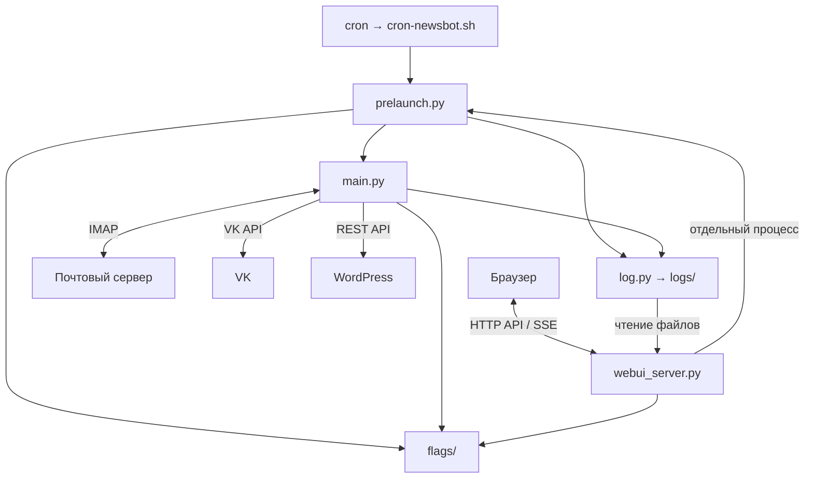

# Zanevka Newsbot — архитектура системы

Карта компонентов и общего состояния приложения. Обязательные решения — [ADR](../decisions.md); правила изменений — [AGENTS.md](../../AGENTS.md). Алгоритм обработки материалов описан в [pipeline.md](pipeline.md).

## Компоненты и взаимодействие

Приложение состоит из Python-конвейера и независимо работающего WebUI на Flask/Waitress. В эксплуатационной среде Ubuntu RELEASE cron запускает POSIX-обёртку, а WebUI при ручном запуске создаёт отдельный процесс. Оба пути используют один лаунчер; конвейер не импортируется сервером ради запуска. Бот работает без WebUI, завершение API не останавливает бот на уровне приложения.

## Карта модулей

| Модуль | Ответственность |
| --- | --- |
| `prelaunch.py` | Системные блокировки, загрузка свежего config.py, режим запуска, жизненный цикл журнала |
| `main.py` | Общая подготовка партии, публикация, итог и очистка |
| `mail_downloader.py` | IMAP, фильтрация, скачивание, резервирование писем и почтовые флаги |
| `eml_parser.py` | Извлечение вложений EML и сохранение изображений |
| `eml_links.py` | Поиск и сопоставление ссылок VK в письмах и DOCX |
| `news_parser.py` | Преобразование DOCX через Pandoc, заголовок, excerpt, сопоставление изображений и сборка новости |
| `integrity_check.py` | Чистый отчёт о полноте партии |
| `image_manager.py` | Загрузка медиа и поиск стандартной картинки WordPress |
| `vk_video.py` | Запросы VK API, рекурсивный поиск видео, сведения о preview |
| `wordpress.py` | Формирование содержимого и создание записи WordPress |
| `log.py` | Форматирование событий, запись и хранение журналов |
| `webui_server.py` | HTTP API, сессии, редактор настроек, запуск и статус, чтение журналов |
| `cron-newsbot.sh` | Проверка запрета расписания и вызов лаунчера |

## Жизненный цикл запуска

1. `prelaunch.main()` получает OS-lock `flags/.main.lock` до импорта конвейера. При занятой блокировке новый экземпляр не обрабатывает письма.
2. Лаунчер удерживает блокировку `flags/.newsbot.running`, загружает точное текущее содержимое config.py без повторного использования устаревшего .pyc, активирует журнал и выполняет очистку старых журналов.
3. Наличие `delayed.publish` определяет аргумент defer_if_incomplete для `main.main()`; конвейер выполняется в том же процессе. Прямой CLI main.py перенаправляет вызов лаунчеру.
4. Конвейер очищает временные EML и изображения в finally и записывает итог. Лаунчер закрывает журнал, при необходимости помечает пустую проверку, закрывает и удаляет running, последним освобождает общий lock.

Состояние процесса определяется системной блокировкой, а не наличием файла. На Unix используется flock, на Windows — msvcrt.locking. API дополнительно отслеживает принятый запуск до появления running и краткую задержку после завершения. Не удалять .main.lock ради разблокировки.

## Служебное состояние

| Файл / каталог | Назначение |
| --- | --- |
| `flags/.main.lock` | Общая системная блокировка партии |
| `flags/.newsbot.running` | Блокировка для определения состояния процесса |
| `flags/.newsbot.disabled` | Запрет следующих cron-запусков |
| `flags/delayed.publish` | Одноразовый признак повторного прохода |
| `flags/*.empty.json` | Метки обычных успешных пустых проверок |
| `logs/` | Каталог журналов по умолчанию |
| `downloaded_eml/` | Каталог временных EML по умолчанию |
| `extracted_images/` | Временные изображения |
| `config.py` | Локальные параметры конвейера, включая секреты |
| `webui_server.local.json` | Локальные параметры HTTP-сервера, логин, хеш пароля и ключ сессии |
| `probe/` | Тесты, диагностика и фикстуры |

Пути flags определяются от каталога проекта независимо от cwd; лаунчер создаёт каталог перед получением lock. Относительный LOG_DIR также разрешается от каталога проекта. Служебное состояние, журналы, рабочие файлы и локальные конфигурации исключены из Git при штатных путях.

Плановый запуск проверяет disabled в POSIX-обёртке; ручной запуск от него не зависит. API читает собственный crontab, но не меняет системные задания или службы. Сброс flags доступен через Debug API под общей блокировкой, сохраняет .main.lock, допускает частичный результат и не затрагивает почту и журналы. Подробности — [HTTP API](../ui/api.md).

## Журналирование

- Один обычный запуск под process lock — один текстовый UTF-8 журнал, имя `DDMMYYYY_HHMMSS_<6 hex>.txt`. Активация повторно не создаёт файл.
- `log.py` получает события и готовые отчёты, не разбирает stdout и не решает, как обрабатывать материалы. Заголовок: `YYYY-MM-DD HH:MM:SS [INFO|OK|WARNING|ERROR] текст`. Физические строки подробностей начинаются табуляцией и наследуют заголовок; новый уровень требует нового блока. Записи сбрасываются сразу; исключения содержат traceback.
- После успешного закрытия обычная пустая проверка без проблем получает метку. Сам бот проверяет её возраст и соответствие файлу и удаляет журнал в начале последующего запуска. Пустой повтор с погашением delayed.publish не помечается; потеря метки означает обычное хранение. Активный журнал не удаляется очисткой. Ошибка записи активного журнала (LogWriteError) останавливает запуск.
- Один серверный читатель LogHub читает файлы по байтовым позициям и передаёт историю и SSE. WebUI не вызывает очистку; исчезновение файла при чтении/обнаружении обработано в LogHub, прочие ошибки чтения диагностируются. Форматы и пределы API — в [HTTP API](../ui/api.md).

Настройки хранения LOG_DIR, LOG_RETENTION_DAYS, LOG_MAX_TOTAL_MB и LOG_EMPTY_MIN_AGE_SECONDS описаны в [развёртывании](../operations/deployment.md). Значения по умолчанию: logs, 30 дней, 200 МиБ, 600 секунд.

## Конфигурация и внешние зависимости

Python-зависимости описаны в requirements.txt; Pandoc — отдельная системная зависимость для преобразования DOCX. Внешние сервисы: IMAP, VK API, WordPress REST API. Примеры конфигурации: config.example.py и webui_server.example.json. Порядок установки и настройки — [развёртывание](../operations/deployment.md).

WebUI редактирует только разрешённые литералы config.py; подробности серверной архитектуры и HTTP-контракта — [API](../ui/api.md), устройство клиентского HTML/CSS/JS и поведение контролов — [WebUI](../ui/admin.md). Публичный снимок истории до входа является существующей границей доступа; проверка сертификата IMAP описана в [pipeline.md](pipeline.md).
